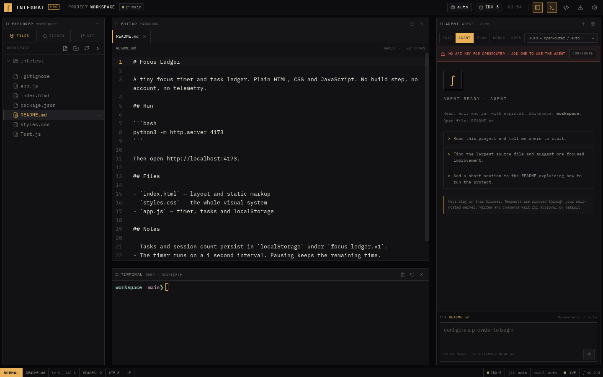
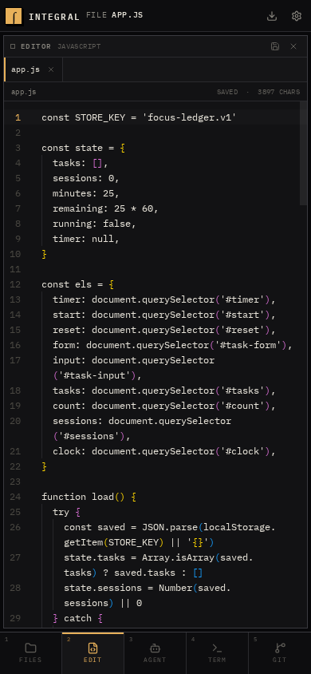

# Integral Pro

A self-hosted coding environment that runs in the browser. Monaco, a real terminal, git, project-wide search, and a bring-your-own-key AI agent, arranged as a tiled workspace instead of a SaaS dashboard.

No account. No subscription. No vendor-owned keys. Your files stay on your machine, and your model keys stay in your browser.



## Why this exists

Cursor's workflow is good. The dependency on a proprietary desktop app, a single model vendor, and a subscription is not. Integral Pro keeps the useful parts — an editor, an agent that can read and change real files, diffs, a terminal, git — and puts them behind a small server you run yourself.

It is also deliberately not another rounded-corner AI product. The interface is built like a tiling window manager: square panes, 1px borders, monospace labels, a Waybar-style status strip, charcoal and amber. Hyprland, not hero section.

## Features

- **Monaco editor** with syntax highlighting, multiple tabs, dirty state, word wrap, font sizing and keyboard save.
- **AI agent with real tools**: list files, read files, search the project, write files, make exact-match edits, run commands, inspect git and create commits.
- **Five working modes**: CHAT, AGENT, PLAN, DEBUG and DOCS, each with its own tool permissions and prompt.
- **BYOK and multi-provider**: OpenRouter, OpenAI, Groq, Ollama, LM Studio, or any OpenAI-compatible endpoint. Different models can be routed to different modes.
- **Streaming responses** with tool-call cards, reasoning display, stop button and markdown rendering.
- **Approval by default**: file writes show a diff before they land; commands show the exact command before it runs. Auto-apply is opt-in.
- **Project-wide search** backed by SQLite FTS5. The index warms itself on boot and can be rebuilt from the UI.
- **Real terminal** over WebSocket, backed by a PTY, with resize and reconnect handling.
- **Git panel** for branch status, the change list, file diffs, commits and history. Works with any repository the server user can access.
- **Exports**: workspace ZIP, conversation Markdown, current-file download, and a settings JSON export/import flow that never includes API keys.
- **Appearance controls**: five accent presets, compact density, reduced motion, editor and terminal font sizes, and word wrap. The charcoal base stays fixed.
- **Mobile support**: below 900px the workspace becomes a single-pane layout with a bottom navigation bar. The PWA manifest makes it installable on a phone.
- **Self-hosted and small**: one Node process, one SQLite file, static frontend. Docker image included.
- **Loopback by default**: the server and Vite bind to `127.0.0.1`, and Docker publishes only to host loopback. Nothing is exposed beyond the machine unless you explicitly change it.
- **Optional access token** for shared or network-exposed instances.

## Modes

| Mode | Tools available | Best for |
| --- | --- | --- |
| CHAT | None | Questions, explanations, design discussion |
| AGENT | All tools | Multi-file changes, commands, verification |
| PLAN | Read-only tools | Implementation plans without touching files |
| DEBUG | All tools | Root-cause analysis and focused fixes |
| DOCS | Read + file edits | Keeping READMEs and docs in sync with code |

Agent modes need a model that supports OpenAI-style tool calling. If a model does not, use CHAT.

## Requirements

- Node.js **22.5 or newer** (Node 24 recommended). The index uses the built-in `node:sqlite` module.
- npm 10+.
- Git is optional, but the git panel and the demo workspace need it.
- Linux or macOS for the bundled PTY. Windows users should use Docker or WSL.

## Quick start

```bash
git clone https://github.com/farhajmaaz-eng/integral-pro.git
cd integral-pro
npm install
npm run dev
```

Open <http://localhost:5173>. The API and terminal server run on port 8787; Vite proxies both. Both processes bind to `127.0.0.1` by default.

On first boot, Integral Pro creates `data/workspace`, copies the small demo project from `example-project/`, initializes git, and makes an initial commit. You get a real project to open instead of an empty editor.

### Production build

```bash
npm run build
ACCESS_TOKEN="$(openssl rand -hex 24)" npm start
```

Open <http://localhost:8787>. The server serves `dist/` and the API from the same origin. It listens on `127.0.0.1` unless `HOST` is set.

### Docker

```bash
cp .env.example .env
# edit .env and set a strong ACCESS_TOKEN
docker compose up --build
```

Open <http://localhost:8787>. Workspace data, the SQLite index and the demo project live in the `integral-data` volume. Compose publishes the port to `127.0.0.1` on the host; the container itself listens on `0.0.0.0` so Docker can reach it.

To work on a project on the host instead:

```bash
docker build -t integral-pro .
docker run --rm -p 127.0.0.1:8787:8787 \
  -e HOST=0.0.0.0 \
  -e ACCESS_TOKEN="$(openssl rand -hex 24)" \
  -e WORKSPACE_DIR=/workspace \
  -v "$PWD/my-project:/workspace" \
  -v integral-data:/app/data \
  integral-pro
```

The container runs as the unprivileged `node` user. Make sure the mounted directory is writable by that user.

## Point it at your own project

Set `WORKSPACE_DIR` to an absolute path:

```bash
WORKSPACE_DIR=/home/me/code/my-project npm start
```

When `WORKSPACE_DIR` is set, Integral Pro does not copy the demo project and does not create a git repository or commit in your project. The terminal starts in that directory. Everything the agent and editor touch is confined to it. The server still binds to loopback by default; use `HOST` only when you intentionally put a reverse proxy in front of it.

## Configure a model

1. Open **Settings → PROVIDERS**.
2. Pick a preset or add a custom OpenAI-compatible provider.
3. Enter the base URL (usually ending in `/v1`) and API key.
4. Use **FETCH** to load the model list, or type model IDs manually.
5. Choose the active model, then optionally assign per-mode routes under **ROUTING**.

Provider presets include OpenRouter, OpenAI, Groq, Ollama and LM Studio. Local providers do not require an API key.

API keys are stored in the browser's `localStorage` and sent with each request to your own server. The server forwards them to the provider and does not write them to disk, the SQLite database or logs. Clearing site data removes them.

## Export and customize

Open the download icon in the top bar, the **EXPORT** command in `Ctrl/Cmd + K`, or press `Ctrl/Cmd + Shift + E`.

- **Workspace archive** streams a ZIP of the workspace. `node_modules`, `.git`, build output, symlinks, `.env*` files (except `.env.example`) and known credential files such as `.npmrc`, `.netrc`, `.git-credentials` and `.pgpass` are skipped. The server caps exports at 5,000 files and 200 MB.
- **Conversation** writes the current transcript as Markdown, including tool calls, results and reasoning.
- **Settings** writes a portable JSON bundle without API keys. Importing validates providers and routes, clamps font sizes and keeps an existing browser key only when that provider's endpoint is unchanged. A file cannot redirect a saved key to a different host.
- **Current file** downloads the active buffer, including unsaved changes.

Appearance lives under **Settings → APPEARANCE**: amber, moss, rust, ice or bone accents; comfortable or compact density; reduced motion; editor and terminal font sizes; and word wrap. Settings are stored in the browser and applied before the first render.

## Security model

Integral Pro is a development tool with real filesystem and shell access. Treat it like an SSH session, not a public website.

- **It is loopback-only by default.** The production server and Vite bind to `127.0.0.1`; Docker Compose publishes to `127.0.0.1` on the host. Changing `HOST` or removing the loopback prefix is an explicit decision to expose it.
- **Set `ACCESS_TOKEN` on any reachable host.** Without it, the API and terminal are open to anyone who can reach the port. The token is a single shared secret, not a multi-user account system.
- **Use TLS and a reverse proxy** if the instance is not on localhost or a private VPN. The built-in server speaks plain HTTP.
- **The terminal is a real shell** running as the server user. It is not a sandbox. The same is true for agent commands, which require approval by default but can be auto-approved in settings.
- **The AI proxy is an authenticated HTTP(S) proxy.** A logged-in client can ask the server to call an arbitrary provider base URL. Restrict outbound network access if that matters for your deployment.
- **File access is confined to the workspace.** Paths are resolved and checked against the workspace root. Every symlink component is rejected, including dangling links, so a write cannot be redirected outside the workspace. Generated and VCS directories are ignored. File reads are capped at 2 MB.
- **Exports skip sensitive files.** Workspace ZIPs omit symlinks, ignored directories, `.env*` files (except `.env.example`) and known credential files. Settings exports never contain API keys, and imports cannot redirect a saved key to a new endpoint.
- **Agent writes and commands are opt-in per action by default.** The diff/command approval modal can be bypassed by enabling auto-apply in Settings, so leave it off on untrusted projects.
- **Run it in a container or VM** if you are pointing it at code you do not fully trust.

This project has not been security-audited. Review the server code before exposing it.

## Keyboard shortcuts

| Shortcut | Action |
| --- | --- |
| `Ctrl/Cmd + S` | Save current file |
| `Ctrl/Cmd + Shift + S` | Save all files |
| `Ctrl/Cmd + P` | Quick open file |
| `Ctrl/Cmd + K` | Command palette |
| `Ctrl/Cmd + J` | Toggle terminal |
| `Ctrl/Cmd + B` | Toggle sidebar |
| `Ctrl/Cmd + Shift + E` | Export workspace, chat or settings |
| `Ctrl/Cmd + Enter` | Commit in the git panel |
| `Enter` | Send chat message |
| `Shift + Enter` | New line in chat |
| `Esc` | Close modal or palette |

On mobile, use the bottom bar to switch between FILES, EDIT, AGENT, TERM and GIT.

## Mobile

The layout switches at 900px. The mobile shell gives one pane at a time, keeps the terminal usable with the on-screen keyboard, and exposes the same agent modes and approvals as the desktop view.



The app ships a web manifest, icons and a small service worker, so it can be added to a phone home screen. The service worker only caches static assets; API and terminal traffic always goes to your server.

## Architecture

```text
Browser
  React 19 + Zustand + Monaco + xterm.js
  agent loop, streaming parser, approval queue
        │  fetch /api/*            │  WebSocket /terminal
        ▼                         ▼
Node server (Express 5)
  files · git · exec · index · AI proxy · auth
  SQLite FTS5 index in DATA_DIR
  PTY child process in WORKSPACE
```

The agent loop runs in the browser. The server exposes capabilities, not conversations. That keeps chat state and API keys client-side, makes approvals immediate, and means the backend has no model-specific logic.

The AI endpoint is a streaming pass-through. It accepts an OpenAI-compatible request, forwards it to the configured base URL, and streams the response back without buffering.

## Project layout

```text
src/
  components/        tiled UI, editor, chat, terminal, git, export, modals
  lib/agent.ts       agent loop, tool definitions, mode permissions
  lib/appearance.ts  accent presets, density, motion, terminal theme
  lib/export.ts      markdown, settings and download helpers
  lib/stream.ts      SSE parser and streaming client
  lib/providers.ts   presets, routing, provider helpers
  store.ts           Zustand state and persisted settings
server/
  index.ts           HTTP server, static frontend, terminal attach
  files.ts           tree, read, write, create, rename, delete
  paths.ts           workspace confinement and symlink checks
  export.ts          streaming workspace ZIP with sensitive-file filters
  git.ts             status, diff, commit, log
  indexer.ts         SQLite FTS5 index and search
  ai.ts              OpenAI-compatible streaming proxy
  terminal.ts        PTY over WebSocket
  auth.ts            optional bearer-token gate
example-project/     demo workspace copied on first boot
tests/               path-safety, export and SSE parser tests
```

## Scripts

```bash
npm run dev        # API + Vite with hot reload
npm run build      # typecheck and production frontend
npm start          # production server on :8787
npm run typecheck  # tsc --noEmit
npm test           # node:test suites in tests/
```

The test suite covers path traversal, symlink escapes (including dangling links), ignored directories, binary and text-file detection, file walking, workspace export filtering, settings import safety and SSE stream parsing.

## API surface

All routes except `/api/health` require the bearer token when `ACCESS_TOKEN` is set.

| Route | Purpose |
| --- | --- |
| `GET /api/health` | Version, workspace, index status |
| `GET /api/files/tree` | Workspace tree |
| `GET /api/files/read?path=` | Read a text file |
| `POST /api/files/write` | Write a file |
| `POST /api/files/create` | Create a file or directory |
| `POST /api/files/rename` | Rename or move |
| `POST /api/files/delete` | Delete |
| `GET /api/index/search?q=` | Full-text search |
| `POST /api/index/rebuild` | Rebuild the index |
| `GET /api/git/status` | Branch, ahead/behind, changes |
| `POST /api/git/init` | Initialize a repository |
| `GET /api/git/diff?path=` | File diff |
| `GET /api/git/log` | Recent commits |
| `POST /api/git/commit` | Stage all and commit |
| `POST /api/exec` | Run a command (approval handled by the client) |
| `POST /api/ai/chat` | Streaming OpenAI-compatible proxy |
| `POST /api/ai/models` | List provider models |
| `GET /api/export/workspace` | Streaming workspace ZIP (filtered) |
| `WS /terminal` | PTY session |

## Limitations

- The agent loop is client-side. Closing the tab stops a run; there is no server-side job queue.
- The index is lexical (SQLite FTS5), not embedding-based. Search is fast and exact, not semantic.
- Monaco provides syntax highlighting and basic suggestions, not full LSP intelligence. There is no debugger.
- One workspace and one shared token per server instance. There are no user accounts, roles or per-user isolation.
- The terminal and exec endpoints are unsandboxed by design. Use a container or VM for untrusted code.
- Workspace exports are capped at 5,000 files and 200 MB, and browser downloads buffer the ZIP in memory. Very large projects should be archived with `git archive` or `tar` instead.
- No collaborative editing, extensions marketplace or remote development protocol.
- Tool-calling quality depends entirely on the model you choose.

## License

MIT. See [LICENSE](LICENSE).
